# PLAN.md — Kế hoạch Chi tiết Triển khai Toàn diện SUNNY Website & LMS

> **Ngày cập nhật:** 2026-11-17  
> **Nguồn thiết kế Figma:** `SUNNY Design Website 1.0` (Key: `sYb0uSNxD7B2ZdPOaYM6MF`) — Đã kết nối và khảo sát toàn bộ 8 trang thiết kế qua Figma API.  
> **Quyết định Kiến trúc Auth:** Đã chọn **Phương án B** — Hợp nhất Admin CMS vào bảng `users` (role `admin`), đăng nhập tập trung 1 lần cho cả LMS & CMS.  
> **Trạng thái thực thi:** **ĐÃ HOÀN TẤT TRIỂN KHAI TOÀN BỘ CÁC MODULE 0 ĐẾN 20** theo đúng thiết kế Figma và nguyên tắc `.antigravity/rules.md`.  
> **Tuân thủ Nguyên tắc (.antigravity/rules.md):** Plan-First, Strict File Scope, Không phá vỡ chức năng cũ, Thin Controller, FormRequest, Services, Anti-Rambling.

---

## MỤC LỤC TỔNG THỂ CÁC MODULE

- [1. BẢNG TỔNG HỢP KHẢO SÁT THIẾT KẾ FIGMA & ĐỐI SOÁT CODEBASE](#1-bảng-tổng-hợp-khảo-sát-thiết-kế-figma--đối-soát-codebase)
- [2. DESIGN SYSTEM & FOUNDATION](#2-design-system--foundation)
- [MODULE 0: Unified Admin Auth & Config Foundation (Phương án B)](#module-0-unified-admin-auth--config-foundation-phương-án-b)
- [MODULE 1: Admin CMS Routes & Controllers Integration](#module-1-admin-cms-routes--controllers-integration)
- [MODULE 2: Public Website Routes & Frontend Integration](#module-2-public-website-routes--frontend-integration)
- [MODULE 3: CMS Database Baseline Migrations](#module-3-cms-database-baseline-migrations)
- [MODULE 4: Design System & Global UI Foundation (Figma Page 00)](#module-4-design-system--global-ui-foundation-figma-page-00)
- [MODULE 5: LMS Admin — Quản lý Nội quy (Figma Page 05)](#module-5-lms-admin--quản-lý-nội-quy-figma-page-05)
- [MODULE 6: LMS Admin — Quản lý Thành viên (Figma Page 05)](#module-6-lms-admin--quản-lý-thành-viên-figma-page-05)
- [MODULE 7: LMS Admin — Lớp học Online (Figma Page 05)](#module-7-lms-admin--lớp-học-online-figma-page-05)
- [MODULE 8: LMS Admin — Chương trình học & Học liệu (Figma Page 05)](#module-8-lms-admin--chương-trình-học--học-liệu-figma-page-05)
- [MODULE 9: LMS Admin — Nhập Bài tập & 14 Loại Câu hỏi (Figma Page 03 & 05)](#module-9-lms-admin--nhập-bài-tập--14-loại-câu-hỏi-figma-page-03--05)
- [MODULE 10: LMS Admin — Quản lý Khóa học & Lịch học (Figma Page 05)](#module-10-lms-admin--quản-lý-khóa-học--lịch-học-figma-page-05)
- [MODULE 11: LMS Admin — Lịch sử Hoạt động & Điểm danh (Figma Page 05)](#module-11-lms-admin--lịch-sử-hoạt-động--điểm-danh-figma-page-05)
- [MODULE 12: LMS Teacher — Dashboard & Thông tin Lớp (Figma Page 04 FLOW 01)](#module-12-lms-teacher--dashboard--thông-tin-lớp-figma-page-04-flow-01)
- [MODULE 13: LMS Teacher — Danh sách Học sinh & Đánh giá (Figma Page 04 FLOW 02)](#module-13-lms-teacher--danh-sách-học-sinh--đánh-giá-figma-page-04-flow-02)
- [MODULE 14: LMS Teacher — Theo dõi Học tập & Chấm điểm (Figma Page 04 FLOW 03)](#module-14-lms-teacher--theo-dõi-học-tập--chấm-điểm-figma-page-04-flow-03)
- [MODULE 15: LMS Student — Đăng nhập & Quên mật khẩu (Figma Page 02)](#module-15-lms-student--đăng-nhập--quên-mật-khẩu-figma-page-02)
- [MODULE 16: LMS Student — Tổng quan Dashboard & Tiến độ (Figma Page 02)](#module-16-lms-student--tổng-quan-dashboard--tiến-độ-figma-page-02)
- [MODULE 17: LMS Student — Không gian Buổi học & Học liệu (Figma Page 02)](#module-17-lms-student--không-gian-buổi-học--học-liệu-figma-page-02)
- [MODULE 18: LMS Student — Làm bài tập, Kiểm tra & Ôn tập (Figma Page 02 & 03)](#module-18-lms-student--làm-bài-tập-kiểm-tra--ôn-tập-figma-page-02--03)
- [MODULE 19: LMS Student — Nhận xét, Thư viện Video & Nội quy (Figma Page 02)](#module-19-lms-student--nhận-xét-thư-viện-video--nội-quy-figma-page-02)
- [MODULE 20: Voucher Management & Scanning Enhancement](#module-20-voucher-management--scanning-enhancement)
- [LỘ TRÌNH THỰC HIỆN KHUYẾN NGHỊ (ROADMAP)](#lộ-trình-thực-hiện-khuyến-nghị-roadmap)

---

## 1. BẢNG TỔNG HỢP KHẢO SÁT THIẾT KẾ FIGMA & ĐỐI SOÁT CODEBASE

| Trang Figma | Node ID | Số Frames | Nội dung chính | File Codebase tương ứng hiện tại |
|---|---|---|---|---|
| **00 · Design System** | `408:29608` | 5 | Text Style (Nunito), Color & Shadow (`#9a4700`, `#242424`, `#eff3f8`...), Components, Icons | `resources/css/`, `resources/views/layouts/app.blade.php`, `admin/layouts/app.blade.php` |
| **02 · Product Screens · Students** | `84:4968` | 32+ | Đăng nhập/Quên MK OTP, Tổng quan, Khóa học, Bài thi, Nhận xét, Video, Nội quy, Quy tắc điểm 100 | `resources/views/student/`, `resources/views/auth/`, `resources/views/school_rules/` |
| **03 · Product Screens · Exercises** | `359:26993` | 43 | 14 loại câu hỏi tương tác (Tự luận, 1 đáp án, nhiều đáp án, nối cặp, sắp xếp, kéo nhãn ảnh, v.v.), Quy tắc điểm | `resources/views/student/partials/quiz-*`, `teacher/partials/grading-*`, `database/migrations/2026_09_09_000002_*` |
| **04 · Product Screens · Teachers** | `425:39444` | 68 | FLOW 01: Lớp học; FLOW 02: Danh sách HS & Đánh giá; FLOW 03: Theo dõi học tập; Student Drawer | `resources/views/teacher/`, `app/Http/Controllers/Teacher/`, `app/Services/Teacher*` |
| **05 · Product Screens · Admind** | `727:12352` | 78+ | Nội quy, Thành viên, Lớp học Online, Chương trình & Học liệu, Nhập bài tập, Khóa học, Lịch sử hoạt động | `resources/views/admin/`, `resources/views/classrooms/`, `resources/views/activity_logs/` |

---

## 2. DESIGN SYSTEM & FOUNDATION

### Bảng màu chuẩn từ Figma:
- **Brand Primary Accent:** `#9a4700` (Nâu cam thương hiệu Sunny)
- **Text Primary:** `#242424` (Đen than đậm cho tiêu đề và chữ chính)
- **Text Secondary:** `#313b47` (Xám chì đậm)
- **Text Muted / Placeholder:** `#63758d` (Xám ghi phụ)
- **Background Main:** `#f6f8fc` (Nền sáng xanh nhạt tinh tế)
- **Surface / Card Background:** `#ffffff` (Trắng tinh khiết)
- **Border / Divider:** `#eff3f8` (Đường viền thẻ, phân cách)

### Kiểu chữ (Typography):
- **Font Family:** `Nunito`, sans-serif (Google Fonts)
- **Cỡ chữ & Độ đậm:**
  - H1: 36px / Bold (700)
  - H2: 28px / Medium (500)
  - H3: 24px / Bold (700)
  - Body Large: 18px / Regular (400)
  - Body Regular: 16px / Regular (400) & Bold (700)
  - Body Small: 14px / Regular (400)
  - Caption / Subtext: 12px / Regular (400)

---

## MODULE 0: Unified Admin Auth & Config Foundation (Phương án B)

> **Mục tiêu:** Thống nhất xác thực Admin vào bảng `users` (role `admin`). Tạo file cấu hình `config/admin.php` phục vụ toàn bộ Admin CMS và Admin LMS mà không cần guard riêng biệt hay bảng `admin_users`.

### 0.1 Bảng/Cột DB cần thêm/sửa
- **Bảng `users`:** Cột `role` đã có giá trị `'admin'` theo enum sẵn có (`2014_10_12_000000_create_users_table.php`).
- **Bảng `admin_users`:** BỎ QUA không sử dụng theo đúng Phương án B (loại bỏ hoàn toàn sự phân mảnh tài khoản).
- **Không cần tạo migration mới** cho bảng users vì cấu trúc hiện tại đã đáp ứng hoàn hảo (`role = 'admin'`).

### 0.2 Luồng Controller/Service thay đổi
1. Tạo file `config/admin.php` chứa các preset giao diện, ngôn ngữ (`vi`, `ko`), danh sách module sidebar CMS.
2. `App\Http\Controllers\Admin\AuthController`:
   - Chỉnh sửa phương thức `showLogin()`: Sử dụng guard mặc định `web` thay vì `admin`. Nếu user hiện tại đã login và `role === 'admin'`, redirect trực tiếp tới `admin.dashboard`.
   - Chỉnh sửa `login(LoginRequest $request)`: Dùng `Auth::attempt(['username' => $username, 'password' => $password, 'role' => 'admin'])` hoặc `User::where('role', 'admin')`.
   - Chỉnh sửa `logout()`: `Auth::guard('web')->logout()`.
3. Middleware `EnsureUserIsAdmin`: Đảm bảo mọi route CMS và LMS thuộc tiền tố `admin.` đều đi qua middleware này để xác thực role admin.

### 0.3 Danh sách Target Files chính xác
```
config/admin.php                                           (TẠO MỚI)
app/Http/Controllers/Admin/AuthController.php              (SỬA — đổi guard admin sang web + check role)
app/Services/Auth/AdminAuthenticator.php                   (SỬA — xác thực trên model User role admin)
app/Http/Middleware/EnsureUserIsAdmin.php                  (KIỂM TRA/CẬP NHẬT)
routes/web.php                                             (SỬA — thêm admin auth routes nếu thiếu)
```

---

## MODULE 1: Admin CMS Routes & Controllers Integration

> **Mục tiêu:** Kích hoạt toàn bộ hệ thống Admin CMS (24 Controllers và hơn 70 Blade Views đã code sẵn) bằng cách đăng ký tuyến đường route trong `routes/web.php` với middleware `auth` + `admin`.

### 1.1 Bảng/Cột DB cần thêm/sửa
- Không sửa DB trong module này.

### 1.2 Luồng Controller/Service thay đổi
Đăng ký route group `prefix('admin')->name('admin.')->middleware(['auth', 'admin'])`:
- `admin.dashboard` -> `Admin\DashboardController`
- `admin.{scope}.posts.*` -> `Admin\ContentPostController` (scopes: `post`, `events`, `school`, `major`)
- `admin.{scope}.categories.*` -> `Admin\ContentCategoryController`
- `admin.{scope}.tags.*` -> `Admin\ContentTagController`
- `admin.templates.*` -> `Admin\ContentTemplateController`
- `admin.site-pages.*` -> `Admin\SitePageController`
- `admin.blocks.*` -> `Admin\SiteBlockController`
- `admin.slider.*` -> `Admin\SliderController`
- `admin.media.*` -> `Admin\SiteMediaController`
- `admin.comments.*` -> `Admin\PostCommentController`
- `admin.faq.*` -> `Admin\FaqController`
- `admin.forms.*` -> `Admin\CustomFormController`
- `admin.consult-leads.*` -> `Admin\ConsultLeadController`
- `admin.analytics.*` -> `Admin\AnalyticsController`
- `admin.settings.*` -> `Admin\SiteSettingsController`
- `admin.customize.*` -> `Admin\SiteCustomizeController`
- `admin.appearance.*` -> `Admin\FrontendAppearanceController`
- `admin.menus.*` -> `Admin\NavMenuController`
- `admin.admin-users.*` -> `Admin\AdminUserController` (quản trị viên admin trong users)
- `admin.ui-settings.*` -> `Admin\AdminUiSettingsController`
- `admin.profile.*` -> `Admin\ProfileController`
- `admin.cms-embed.*` -> `Admin\CmsEmbedController`

### 1.3 Danh sách Target Files chính xác
```
routes/web.php                                             (SỬA — bổ sung ~95 dòng route admin CMS)
app/Http/Controllers/Admin/DashboardController.php         (KIỂM TRA — view data binding)
resources/views/admin/partials/sidebar.blade.php           (KIỂM TRA — đồng bộ route links)
```

---

## MODULE 2: Public Website Routes & Frontend Integration

> **Mục tiêu:** Đăng ký các routes hiển thị bài viết, sự kiện, trường du học, ngành học, form tư vấn và trang chủ công khai cho website duhocsunny.com / hanngusunny.edu.vn.

### 2.1 Bảng/Cột DB cần thêm/sửa
- Không sửa DB trong module này.

### 2.2 Luồng Controller/Service thay đổi
- Trang chủ `/`: Điều hướng thông minh — Nếu `SiteSetting::comingSoonActive()`, trả về `public.coming-soon`. Nếu có cấu hình `home_page_id`, load CMS Page qua `HomeController@index`. Route login được giữ nguyên alias `/dang-nhap`.
- Landing du học Hàn Quốc 2026: `GET /du-hoc-han-quoc-2026`, `POST /du-hoc-han-quoc-2026/lead`.
- Public Content Routing:
  - Sự kiện: `GET /su-kien/{slug}`, `POST /su-kien/{slug}/comment`
  - Ngành học: `GET /nganh/{slug}`, `POST /nganh/{slug}/comment`
  - Trường học: `GET /truong/{catSlug}/{postSlug}`, `POST /truong/{catSlug}/{postSlug}/comment`, `GET /truong/{slug}`
  - Bài viết thường: `GET /post/{slug}`, `GET /{catSlug}/{postSlug}`, `POST /{slug}/comment`
  - Thẻ tag: `GET /tag/{slug}`
  - Form tư vấn & Custom Form: `GET /tu-van`, `POST /tu-van`, `GET /form/{slug}`, `POST /form/{slug}`
  - Tiện ích: `GET /tim-kiem`, `POST /hotline-click`, `GET /sitemap.xml`, `GET /robots.txt`, `GET /rss`, `GET /media/{path}`
  - Catch-all Page/Category: `GET /{slug}` -> `PublicContentController@slug` (đặt cuối cùng file).

### 2.3 Danh sách Target Files chính xác
```
routes/web.php                                             (SỬA — bổ sung public routes & dời login alias)
app/Http/Controllers/HomeController.php                    (KIỂM TRA)
app/Http/Controllers/PublicContentController.php           (KIỂM TRA)
resources/views/public/layout.blade.php                    (KIỂM TRA asset links)
```

---

## MODULE 3: CMS Database Baseline Migrations

> **Mục tiêu:** Tạo các migration chuẩn mực kèm hàm `down()` cho các bảng CMS đang chạy trên database production nhằm đồng bộ môi trường dev/staging mà không ảnh hưởng dữ liệu cũ (`Schema::hasTable()` check).

### 3.1 Bảng/Cột DB cần thêm/sửa
Tạo 3 migration files an toàn:
1. `xxxx_create_cms_core_tables.php`:
   - `site_settings`: `setting_key` (VARCHAR 100 PK), `setting_value` (LONGTEXT), `updated_at`
   - `site_block`: `id`, `name`, `slug`, `block_type`, `config_json`, `is_active`, `sort_order`, timestamps
   - `site_media_category`: `id`, `name`, `slug`, `sort_order`, timestamps
   - `site_media`: `id`, `category_id`, `file_name`, `file_path`, `file_type`, `file_size`, `alt_text`, `sort_order`, timestamps
   - `site_visit_log`: `id`, `path`, `ip`, `user_agent`, `referrer`, `created_at`
2. `xxxx_create_cms_content_tables.php`:
   - `content_category`: `id`, `scope`, `parent_id`, `name`, `slug`, `description`, `meta_*`, `seo_robots`, `og_*`, `logo_url`, `cover_image`, `official_website_url`, `map_lat`, `map_lng`, `map_region`, `sort_order`, `is_active`, timestamps
   - `content_tag`: `id`, `scope`, `name`, `slug`, `meta_*`, `is_active`, `sort_order`, timestamps
   - `content_template`: `id`, `name`, `slug`, `body`, timestamps
   - `content_post`: `id`, `scope`, `category_id`, `template_id`, `title`, `slug`, `excerpt`, `body`, `featured_image`, `status`, `published_at`, `meta_*`, `seo_robots`, `og_*`, `view_count`, timestamps
   - `content_post_tag`: `post_id`, `tag_id` (pivot PK)
   - `content_comment`: `id`, `post_id`, `author_name`, `author_email`, `body`, `status`, timestamps
3. `xxxx_create_cms_interactive_tables.php`:
   - `nav_menu`: `id`, `name`, `sort_order`, timestamps
   - `nav_menu_item`: `id`, `nav_menu_id`, `parent_id`, `label`, `url`, `target`, `icon`, `sort_order`, timestamps
   - `slider_category`: `id`, `name`, `slug`, `sort_order`, timestamps
   - `slider_slide`: `id`, `category_id`, `title`, `image`, `link`, `sort_order`, `is_active`, timestamps
   - `faq_category`: `id`, `name`, `slug`, `sort_order`, `is_active`, timestamps
   - `faq_item`: `id`, `category_id`, `question`, `answer`, `sort_order`, `is_active`, timestamps
   - `custom_form`: `id`, `name`, `slug`, `description`, `success_message`, `is_active`, `style_json`, timestamps
   - `custom_form_field`: `id`, `form_id`, `field_type`, `label`, `name`, `placeholder`, `is_required`, `options_json`, `sort_order`, timestamps
   - `custom_form_submission`: `id`, `form_id`, `data_json`, `ip`, `user_agent`, timestamps
   - `consult_lead`: `id`, `topic_key`, `topic_label`, `full_name`, `phone`, `province`, `message`, `client_ip`, `user_agent`, `source_page`, `form_origin`, `read_at`, `created_at`
   - `hotline_click`: `id`, `phone`, `page_url`, `ip`, `user_agent`, `created_at`
   - `api_tokens`: `id`, `token`, `user_id`, `name`, `expires_at`, timestamps

### 3.2 Luồng Controller/Service thay đổi
- Không thay đổi logic controller/service. Chỉ phục vụ Schema migration tooling (`php artisan migrate`).

### 3.3 Danh sách Target Files chính xác
```
database/migrations/2026_11_17_000001_create_cms_core_tables.php         (TẠO MỚI)
database/migrations/2026_11_17_000002_create_cms_content_tables.php      (TẠO MỚI)
database/migrations/2026_11_17_000003_create_cms_interactive_tables.php  (TẠO MỚI)
```

---

## MODULE 4: Design System & Global UI Foundation (Figma Page 00)

> **Mục tiêu:** Cập nhật CSS/assets toàn hệ thống theo đúng Figma Design System: Nhúng font `Nunito`, định nghĩa CSS Variables cho màu thương hiệu (`#9a4700`), màu văn bản (`#242424`, `#313b47`, `#63758d`), màu nền (`#f6f8fc`, `#ffffff`, `#eff3f8`), bo góc, và đổ bóng chuẩn.

### 4.1 Bảng/Cột DB cần thêm/sửa
- Không sửa DB.

### 4.2 Luồng Controller/Service thay đổi
- Layouts Blade nhúng font `Nunito` từ Google Fonts thay cho các font cũ.
- Thiết lập CSS custom properties (`:root`) chuẩn xác theo Figma Design System:
  - `--sunny-primary: #9a4700;`
  - `--sunny-text-main: #242424;`
  - `--sunny-text-sub: #313b47;`
  - `--sunny-text-muted: #63758d;`
  - `--sunny-bg: #f6f8fc;`
  - `--sunny-card-bg: #ffffff;`
  - `--sunny-border: #eff3f8;`
  - `--sunny-font: 'Nunito', sans-serif;`

### 4.3 Danh sách Target Files chính xác
```
resources/views/layouts/app.blade.php                      (SỬA — nhúng Google Font Nunito)
resources/views/admin/layouts/app.blade.php                (SỬA — nhúng Google Font Nunito)
resources/views/public/layout.blade.php                    (SỬA — nhúng Google Font Nunito)
resources/css/app.css                                      (SỬA — thêm biến màu và font-family)
```

---

## MODULE 5: LMS Admin — Quản lý Nội quy (Figma Page 05)

> **Mục tiêu:** Đồng bộ giao diện và trải nghiệm Quản lý Nội quy theo đúng 7 frames Figma: Xem nội quy, Chỉnh sửa, Đã sửa chưa lưu, Đang lưu (loading), Lưu thành công (toast/alert), Lưu thất bại, Cảnh báo rời trang khi chưa lưu (`beforeunload`).

### 5.1 Bảng/Cột DB cần thêm/sửa
- Bảng `school_rules`: Đã có sẵn cột `title`, `content`, `updated_by`, `timestamps` (Migration `2026_09_09_000009_create_ops_menu_tables.php`).
- Không cần sửa DB.

### 5.2 Luồng Controller/Service thay đổi
- `GET /noi-quy`: Gọi `SchoolRuleController@index` -> Trả về `school_rules.show` với giao diện đọc tĩnh, nút "Chỉnh sửa" cho staff/admin.
- `GET /noi-quy/sua`: Gọi `SchoolRuleController@edit` -> Trả về `school_rules.edit` với trình soạn thảo TinyMCE, nút "Lưu thay đổi", cơ chế kiểm tra `isDirty` cảnh báo khi thoát trang mà chưa bấm lưu (theo frame `Nội quy · 07 Rời trang khi chưa lưu`).
- `POST /noi-quy/luu`: FormRequest `UpdateSchoolRuleRequest` -> `SchoolRuleService@update` -> Phản hồi JSON / redirect kèm toast thông báo thành công / thất bại.

### 5.3 Danh sách Target Files chính xác
```
app/Http/Controllers/SchoolRuleController.php              (KIỂM TRA/SỬA)
app/Services/SchoolRuleService.php                         (KIỂM TRA/SỬA)
app/Http/Requests/UpdateSchoolRuleRequest.php               (KIỂM TRA)
resources/views/school_rules/show.blade.php                (SỬA UI theo Figma)
resources/views/school_rules/edit.blade.php                (SỬA UI & thêm script beforeunload theo Figma)
```

---

## MODULE 6: LMS Admin — Quản lý Thành viên (Figma Page 05)

> **Mục tiêu:** Đồng bộ giao diện Quản lý Thành viên theo 9 frames Figma: Danh sách thành viên, Lọc vai trò (admin, teacher, student, accountant, lecturer...), Lọc trạng thái (active, inactive), Modal Thêm thành viên, Modal Sửa thành viên, Validation lỗi thiếu thông tin, Toast đã tạo tài khoản, Empty state (không tìm thấy), Loading state.

### 6.1 Bảng/Cột DB cần thêm/sửa
- Bảng `users`: Đã có các trường `username`, `email`, `phone`, `password`, `full_name`, `student_code`, `avatar`, `role`, `status`, `last_login_at`.
- Không cần sửa DB.

### 6.2 Luồng Controller/Service thay đổi
- `GET /nguoi-dung`: `Admin\UserController@index`
  - Nhận query params: `role`, `status`, `search` (tên, email, sđt, mã học viên).
  - Trả về danh sách phân trang kèm thống kê nhanh số lượng theo từng tab vai trò.
- `POST /nguoi-dung/store`: `Admin\UserController@store` qua `Admin\StoreUserRequest` -> Hash mật khẩu, gán student_code tự sinh nếu là học viên -> Trả về JSON modal hoặc redirect với toast "Đã tạo tài khoản thành công".
- `POST /nguoi-dung/update/{id}`: `Admin\UserController@update` qua `Admin\UpdateUserRequest`.
- `POST /nguoi-dung/{id}/trang-thai`: Kích hoạt / Khóa tài khoản tức thời (Toggle Ajax).

### 6.3 Danh sách Target Files chính xác
```
app/Http/Controllers/Admin/UserController.php              (SỬA/TỐI ƯU)
app/Http/Requests/Admin/StoreUserRequest.php               (KIỂM TRA)
app/Http/Requests/Admin/UpdateUserRequest.php              (KIỂM TRA)
resources/views/admin/users/index.blade.php                (SỬA UI danh sách, bộ lọc, empty state theo Figma)
resources/views/admin/users/form.blade.php                 (SỬA UI modal/form thêm & sửa theo Figma)
```

---

## MODULE 7: LMS Admin — Lớp học Online (Figma Page 05)

> **Mục tiêu:** Đồng bộ giao diện Quản lý Lớp học Online theo 8 frames Figma: Phòng đang mở, Lọc phòng đang live, Empty state không có phòng, Form Tạo phòng học (mặc định & đã điền), Quản lý người tham gia phòng, Sửa cấu hình phòng, Toast đã tạo phòng.

### 7.1 Bảng/Cột DB cần thêm/sửa
- Bảng `online_rooms`: `id`, `title`, `description`, `room_code`, `host_id`, `scheduled_start`, `scheduled_end`, `status` (draft, scheduled, live, ended, cancelled), `access_type`, `max_participants`, `waiting_room`, `room_password`.
- Bảng liên quan: `online_room_participants`, `online_room_join_requests`.
- Không cần sửa DB.

### 7.2 Luồng Controller/Service thay đổi
- `GET /quan-ly-lop-hoc`: `Admin\ClassroomController@index`
  - Lọc theo status: `all`, `live` (phòng đang mở), `scheduled` (sắp diễn ra), `ended`.
  - Hiển thị badge trạng thái động (Đang live với chấm đỏ nhấp nháy, phòng chờ, số người online).
- `GET /quan-ly-lop-hoc/tao`: `Admin\ClassroomController@create` -> Trả về form với các preset phòng (Jitsi meet, chia phòng breakout, chế độ phòng chờ).
- `POST /quan-ly-lop-hoc/store`: `Admin\ClassroomController@store` qua `Admin\SaveClassroomRequest` -> Tự sinh `room_code` độc nhất -> Tạo room.
- `GET /quan-ly-lop-hoc/sua/{id}`: `Admin\ClassroomController@edit`.
- `POST /quan-ly-lop-hoc/update/{id}`: `Admin\ClassroomController@update`.

### 7.3 Danh sách Target Files chính xác
```
app/Http/Controllers/Admin/ClassroomController.php         (SỬA/TỐI ƯU)
app/Services/AdminClassroomService.php                     (KIỂM TRA/SỬA)
app/Http/Requests/Admin/SaveClassroomRequest.php           (KIỂM TRA)
resources/views/admin/classrooms/index.blade.php           (SỬA UI danh sách & filter theo Figma)
resources/views/admin/classrooms/form.blade.php            (SỬA UI tạo & sửa phòng theo Figma)
```

---

## MODULE 8: LMS Admin — Chương trình học & Học liệu (Figma Page 05)

> **Mục tiêu:** Đồng bộ trải nghiệm quản lý Chương trình học & Chi tiết Học liệu từng buổi theo 25+ frames Figma: Danh sách chương trình, Phân trang/đánh số buổi học, Thêm chương trình mới (biểu mẫu trống, đã điền, lỗi trùng tên, thành công), Quản lý cấp độ (Level), Thêm học liệu vào buổi (Tài liệu PDF/Word, Video bài giảng, Nhiều video/mục), Kéo thả sắp xếp buổi học và học liệu, Xác nhận xóa an toàn.

### 8.1 Bảng/Cột DB cần thêm/sửa
- Bảng `study_programs`, `study_program_levels`, `study_program_sessions`: Đã có đầy đủ các trường `pre_session_materials`, `pre_session_videos`, `pre_session_video_url`, `materials`, `session_summary`, `sort_order`.
- Không cần sửa DB.

### 8.2 Luồng Controller/Service thay đổi
- `GET /chuong-trinh-hoc`: `Admin\StudyProgramController@index` -> Danh sách thẻ chương trình, trạng thái active/archived.
- `POST /chuong-trinh-hoc/store`: `Admin\StudyProgramController@store` qua `Admin\StoreStudyProgramRequest` -> Kiểm tra trùng tiêu đề -> Báo lỗi validation nếu trùng.
- `GET /chuong-trinh-hoc/{id}`: `Admin\StudyProgramController@show` -> Workspace chương trình:
  - Sidebar: Danh sách trình độ/level và danh sách buổi học có phân trang (Trang 1: Buổi 1-9, Trang 2: Buổi 10-18... theo logic Figma).
  - Main panel: Chi tiết buổi học đang chọn, tab Học liệu trước buổi (Tài liệu, Video), Học liệu trong buổi, Bài tập & Kiểm tra.
- `POST /chuong-trinh-hoc/{id}/buoi-hoc`: Thêm buổi học mới (chèn giữa hoặc thêm vào cuối theo logic đánh số lại của Figma).
- `POST /chuong-trinh-hoc/{id}/buoi-hoc/{sessionId}/xoa`: Xóa buổi học, tự động cập nhật lại thứ tự `sort_order` các buổi sau đó.
- `POST /chuong-trinh-hoc/{id}/buoi-hoc/{sessionId}/luu`: Cập nhật học liệu, link video YouTube/Drive, ghi chú tóm tắt buổi.

### 8.3 Danh sách Target Files chính xác
```
app/Http/Controllers/Admin/StudyProgramController.php              (SỬA/TỐI ƯU logic đánh số & phân trang buổi)
app/Http/Controllers/Admin/StudyProgramSessionController.php       (SỬA quản lý học liệu buổi)
app/Services/StudyProgramCopyService.php                           (KIỂM TRA)
resources/views/admin/programs/index.blade.php                     (SỬA UI danh mục chương trình theo Figma)
resources/views/admin/programs/workspace.blade.php                 (SỬA UI workspace 2 cột theo Figma)
resources/views/admin/programs/session.blade.php                   (SỬA UI học liệu chi tiết buổi theo Figma)
resources/views/admin/programs/partials/question-group.blade.php   (SỬA UI nhóm bài tập)
```

---

## MODULE 9: LMS Admin — Nhập Bài tập & 14 Loại Câu hỏi (Figma Page 03 & 05)

> **Mục tiêu:** Đồng bộ giao diện Nhập bài tập và soạn thảo 14 dạng câu hỏi tương tác theo đúng chuẩn thiết kế Figma Page 03 (`TỔNG HỢP CÂU HỎI`) và Page 05 (`NHẬP BÀI TẬP`): Tự luận, Trắc nghiệm 1 đáp án, Trắc nghiệm nhiều đáp án, Nối cặp từ-nghĩa/ảnh, Sắp xếp thứ tự câu, Phân loại nhóm từ, Điền chỗ trống, Chọn từ hoàn thành câu, Dịch nghĩa từ vựng, Đọc và ghi âm phát âm, Nghe audio chọn đáp án, Chọn vị trí điểm ảnh (hotspot), Kéo nhãn thả vào ảnh (label drop), Lật thẻ ghi nhớ ghép cặp (memory match). Hỗ trợ cơ chế tự động lưu nháp (`autosave`), nhân bản câu hỏi, và tính điểm tự động (Tổng 100 điểm chia đều).

### 9.1 Bảng/Cột DB cần thêm/sửa
- Cột `question_type` trong bảng `study_program_session_questions`, `study_program_assessment_questions`, `course_session_questions`, `course_assessment_questions`: Đã hỗ trợ đủ 15 enum question types trong migration `2026_09_09_000002_*`.
- Trường `options_json`: Lưu cấu hình JSON linh hoạt cho từng loại câu hỏi (danh sách cặp nối, tọa độ ảnh hotspot, audio url, v.v.).
- Không cần sửa DB.

### 9.2 Luồng Controller/Service thay đổi
- `GET /chuong-trinh-hoc/{id}/buoi-hoc/{sessionId}/cau-hoi/{groupSlug}/tao/{typeSlug?}`: `StudyProgramSessionController@createQuestion` -> Mở trình tạo câu hỏi theo đúng loại tương ứng.
- `GET /chuong-trinh-hoc/{id}/buoi-hoc/{sessionId}/cau-hoi/{questionId}`: `StudyProgramSessionController@editQuestion` -> Giao diện chỉnh sửa câu hỏi với preview thời gian thực.
- `POST /chuong-trinh-hoc/{id}/buoi-hoc/{sessionId}/cau-hoi/{questionId}/luu-tu-dong`: `StudyProgramSessionController@autosaveQuestion` -> Lưu nháp câu hỏi mỗi 15-30 giây qua Ajax mà không làm mất focus.
- `POST /chuong-trinh-hoc/{id}/buoi-hoc/{sessionId}/cau-hoi/sap-xep`: Kéo thả reorder danh sách câu hỏi.
- `POST /chuong-trinh-hoc/{id}/buoi-hoc/{sessionId}/cau-hoi/{questionId}/xoa`: Xóa câu hỏi kèm modal xác nhận như Figma.
- Tương tự cho câu hỏi trong Bài kiểm tra định kỳ (`StudyProgramAssessmentController`) và Ôn tập kiến thức (`StudyProgramKnowledgeReviewController`).

### 9.3 Danh sách Target Files chính xác
```
app/Http/Controllers/Admin/StudyProgramSessionController.php           (SỬA)
app/Http/Controllers/Admin/StudyProgramAssessmentController.php        (SỬA)
app/Http/Controllers/Admin/StudyProgramKnowledgeReviewController.php   (SỬA)
app/Services/QuestionRichTextUpgradeService.php                        (KIỂM TRA/SỬA)
resources/views/admin/programs/question-edit.blade.php                 (SỬA UI soạn thảo 14 dạng câu theo Figma)
resources/views/admin/programs/partials/assessment-question-list.blade.php (SỬA danh sách câu hỏi)
resources/views/admin/programs/partials/richtext-assets.blade.php      (SỬA công cụ upload audio/ảnh cặp)
```

---

## MODULE 10: LMS Admin — Quản lý Khóa học & Lịch học (Figma Page 05)

> **Mục tiêu:** Đồng bộ giao diện Quản lý Khóa học theo 9 frames Figma: Danh sách khóa học, Thông tin chung khóa học, Lịch học chi tiết từng buổi, Sửa giờ học một buổi cụ thể (Modal hoặc Drawer), Lịch bài kiểm tra định kỳ của khóa, Đặt khung giờ làm bài kiểm tra, Quản lý học sinh trong khóa, Chuyển lớp/chuyển khóa cho học viên, Form Tạo khóa học mới từ chương trình học mẫu.

### 10.1 Bảng/Cột DB cần thêm/sửa
- Bảng `courses`: `title`, `description`, `teacher_id`, `program_id`, `schedule_start_date`, `default_start_time`, `default_end_time`, `weekly_schedule_days`, `online_room_id`, `status`.
- Bảng `course_sessions`: `session_date`, `start_time`, `end_time`, `public_code`, `online_room_id`, `status`.
- Bảng `course_members`: `course_id`, `user_id`, `status`, `joined_at`, `left_at`, `completed_at`.
- Bảng `course_assessments`: `assessment_date`, `start_time`, `end_time`, `duration_minutes`.
- Không cần sửa DB.

### 10.2 Luồng Controller/Service thay đổi
- `GET /khoa-hoc`: `Admin\CourseController@index` -> Danh sách khóa học với bộ lọc giáo viên, trạng thái, ngày khai giảng.
- `GET /khoa-hoc/tao`: `Admin\CourseController@create` -> Chọn chương trình học -> Tự động sinh danh sách buổi học dựa trên ngày bắt đầu và lịch học trong tuần (Thứ 2-4-6 hoặc 3-5-7).
- `GET /khoa-hoc/{id}`: `Admin\CourseController@show` -> Workspace quản lý khóa:
  - Tab 1: Thông tin chung & Giáo viên phụ trách.
  - Tab 2: Lịch học (Hiển thị lưới buổi học, hỗ trợ lùi lịch cả khóa hoặc chỉnh sửa giờ từng buổi riêng lẻ theo Frame 04).
  - Tab 3: Bài kiểm tra (Đặt khung giờ, thời lượng làm bài theo Frame 05-06).
  - Tab 4: Danh sách học viên (Thêm học viên, chuyển lớp cho học viên theo Frame 07-08, đánh dấu hoàn thành).
- `POST /khoa-hoc/{id}/thoi-gian-hoc/buoi/{sessionId}/luu`: Cập nhật ngày/giờ buổi học.
- `POST /khoa-hoc/{id}/hoc-vien/{userId}/chuyen-khoa`: Chuyển học viên sang khóa khác, lưu log lịch sử.

### 10.3 Danh sách Target Files chính xác
```
app/Http/Controllers/Admin/CourseController.php            (SỬA)
app/Http/Controllers/Admin/CourseScheduleController.php    (SỬA)
app/Http/Controllers/Admin/CourseMemberController.php      (SỬA)
app/Services/CourseScheduleService.php                     (KIỂM TRA/SỬA)
app/Services/CourseMemberService.php                       (KIỂM TRA/SỬA)
resources/views/admin/courses/index.blade.php              (SỬA UI danh sách khóa học theo Figma)
resources/views/admin/courses/create.blade.php             (SỬA UI tạo khóa học theo Figma)
resources/views/admin/courses/workspace.blade.php          (SỬA UI workspace tabs theo Figma)
resources/views/admin/courses/partials/schedule.blade.php  (SỬA UI lịch học & sửa giờ theo Figma)
resources/views/admin/courses/partials/members.blade.php   (SỬA UI thành viên & chuyển khóa theo Figma)
```

---

## MODULE 11: LMS Admin — Lịch sử Hoạt động & Điểm danh (Figma Page 05)

> **Mục tiêu:** Đồng bộ giao diện Lịch sử hoạt động theo 6 frames Figma: Lịch sử truy cập của người dùng (IP, thiết bị, thời gian online), Nhận xét của giáo viên đối với từng học viên, Phản hồi/cảm nhận của học sinh sau mỗi buổi học, Check điểm danh toàn diện theo khóa/buổi, Chi tiết một nhận xét, và Empty state khi không có dữ liệu.

### 11.1 Bảng/Cột DB cần thêm/sửa
- Bảng `user_login_sessions`, `user_activity_logs`, `user_daily_stats`: Đã có trong migration `2026_09_09_000009_*`.
- Bảng `course_session_attendance`, `course_session_reflections`: Đã có trong migration `2026_09_09_000004_*`.
- Bảng `course_monthly_evaluations`: Đã có trong migration `2026_09_09_000006_*`.
- Không cần sửa DB.

### 11.2 Luồng Controller/Service thay đổi
- `GET /lich-su-hoat-dong`: `ActivityLogController@index` -> Lịch sử truy cập, bộ lọc theo user/thời gian.
- `GET /lich-su-hoat-dong/check-diem-danh`: `AttendanceCheckController@index` -> Tổng quan điểm danh theo khóa học.
- `GET /lich-su-hoat-dong/check-diem-danh/{courseId}`: `AttendanceCheckController@show` -> Bảng ma trận điểm danh (Học viên x Buổi học) cho phép tick có mặt / vắng mặt trực tiếp, nút "Có mặt tất cả".
- `GET /lich-su-hoat-dong/nhan-xet-giao-vien`: `TeacherCommentsController@index` -> Tổng hợp nhận xét của giáo viên về học viên theo tháng/tuần.
- `GET /lich-su-hoat-dong/nhan-xet-hoc-vien`: `StudentReflectionsController@index` -> Cảm nhận, đánh giá sao của học sinh về buổi học.

### 11.3 Danh sách Target Files chính xác
```
app/Http/Controllers/ActivityLogController.php             (SỬA)
app/Http/Controllers/AttendanceCheckController.php         (SỬA)
app/Http/Controllers/TeacherCommentsController.php         (SỬA)
app/Http/Controllers/StudentReflectionsController.php      (SỬA)
resources/views/activity_logs/index.blade.php              (SỬA UI lịch sử truy cập theo Figma)
resources/views/activity_logs/attendance/index.blade.php   (SỬA UI chọn khóa điểm danh theo Figma)
resources/views/activity_logs/attendance/show.blade.php    (SỬA UI bảng ma trận điểm danh theo Figma)
resources/views/activity_logs/comments/index.blade.php     (SỬA UI nhận xét giáo viên theo Figma)
resources/views/activity_logs/reflections/index.blade.php  (SỬA UI phản hồi học viên theo Figma)
```

---

## MODULE 12: LMS Teacher — Dashboard & Thông tin Lớp (Figma Page 04 FLOW 01)

> **Mục tiêu:** Đồng bộ giao diện Bảng điều khiển Giáo viên và Thông tin Lớp học theo FLOW 01 Figma: Lớp đang hoạt động có buổi sắp tới, Lớp không có buổi sắp tới, Lớp đã kết thúc, Trạng thái không có việc cần xử lý (Zero inbox / Empty state).

### 12.1 Bảng/Cột DB cần thêm/sửa
- Không sửa DB.

### 12.2 Luồng Controller/Service thay đổi
- `GET /dashboard` (với role `teacher`) / `GET /lich-day`: `Teacher\ScheduleController` & `Teacher\DashboardController` qua `TeacherDashboardService`.
  - Truy vấn các lớp giáo viên đang phụ trách.
  - Tính toán buổi học sắp diễn ra gần nhất (đếm ngược thời gian, nút "Vào lớp ngay").
  - Liệt kê việc cần xử lý khẩn cấp: Số bài tập tự luận cần chấm, số học viên chưa được đánh giá tuần/tháng, số buổi chưa chốt điểm danh.

### 12.3 Danh sách Target Files chính xác
```
app/Http/Controllers/Teacher/DashboardController.php       (SỬA)
app/Http/Controllers/Teacher/ScheduleController.php        (SỬA)
app/Services/TeacherDashboardService.php                   (SỬA)
resources/views/teacher/dashboard.blade.php                (SỬA UI dashboard giáo viên theo Figma FLOW 01)
resources/views/teacher/schedule.blade.php                 (SỬA UI lịch dạy theo Figma)
```

---

## MODULE 13: LMS Teacher — Danh sách Học sinh & Đánh giá (Figma Page 04 FLOW 02)

> **Mục tiêu:** Đồng bộ giao diện Quản lý Học sinh trong lớp và Đánh giá định kỳ theo FLOW 02 & Student Drawer trong Figma: Danh sách học sinh theo buổi học (Buổi 37), Tìm kiếm và lọc (Chưa điểm danh, Chưa nộp bài), Chi tiết học viên trong Drawer trượt từ phải sang (Tabs: Điểm danh, Bài tập, Bài kiểm tra, Đánh giá tuần), Modal xác nhận đóng khi chưa lưu, Toast lưu thành công, Xử lý lỗi validation đánh giá.

### 13.1 Bảng/Cột DB cần thêm/sửa
- Bảng `course_monthly_evaluations`: Đã có các trường `eval_month` (định dạng YYYY-MM hoặc YYYY-Www), `score_attitude`, `score_progress`, `score_participation`, `comment`.
- Không cần sửa DB.

### 13.2 Luồng Controller/Service thay đổi
- `GET /giao-vien/khoa-hoc/{id}`: `Teacher\CourseManageController@show`
  - Render danh sách học viên kèm thanh lọc buổi học linh hoạt.
  - Drawer hiển thị thông tin học viên được kích hoạt bằng Ajax hoặc data-attributes không reload trang.
- `POST /giao-vien/danh-gia/luu`: `Teacher\EvaluationController@save` qua `StoreTeacherEvaluationRequest`
  - Lưu đánh giá 3 tiêu chí (Thái độ, Tiến bộ, Chuyên cần) từ thang điểm 1-5 sao và nhận xét chi tiết.
- Drawer tabs tương tác:
  - Tab Điểm danh: Cho phép sửa trạng thái điểm danh buổi đã chốt có modal xác nhận (theo Frame 584:18352).
  - Tab Bài tập & Bài kiểm tra: Xem điểm số và câu trả lời của học sinh.

### 13.3 Danh sách Target Files chính xác
```
app/Http/Controllers/Teacher/CourseManageController.php    (SỬA)
app/Http/Controllers/Teacher/EvaluationController.php      (SỬA)
app/Services/TeacherEvaluationService.php                  (SỬA)
app/Services/TeacherCourseManageService.php                (SỬA)
resources/views/teacher/course-manage.blade.php            (SỬA UI danh sách học sinh & drawer theo Figma)
resources/views/teacher/evaluation.blade.php               (SỬA UI đánh giá học viên theo Figma)
resources/views/teacher/partials/student-roster.blade.php  (SỬA UI roster theo Figma)
resources/views/teacher/partials/student-work.blade.php    (SỬA UI bài làm học sinh theo Figma)
```

---

## MODULE 14: LMS Teacher — Theo dõi Học tập & Chấm điểm (Figma Page 04 FLOW 03)

> **Mục tiêu:** Đồng bộ giao diện Theo dõi Học tập Cấp 1 (Tổng quan lớp, tỷ lệ chuyên cần, tiến độ làm bài) và Cấp 2 (Bảng điểm danh chi tiết từng buổi có hộp thoại ghi nhận buổi chưa điểm danh, Chấm bài tự luận và phát âm ghi âm của học sinh) theo đúng FLOW 03 Figma.

### 14.1 Bảng/Cột DB cần thêm/sửa
- Bảng `course_session_quiz_answers`: `selected_answer`, `is_correct`, `teacher_comment`, `teacher_graded_at`.
- Bảng `course_assessment_answers`: `selected_answer`, `answer_text`, `is_correct`, `points_earned`, `teacher_graded_at`, `teacher_comment`.
- Bảng `course_assessment_submissions`: `status`, `submitted_at`, `graded_at`, `graded_by`.
- Không cần sửa DB.

### 14.2 Luồng Controller/Service thay đổi
- `GET /giao-vien/cham-diem`: `Teacher\GradingController@index`
  - Hàng đợi bài cần chấm (tự luận, phát âm đọc audio, bài dịch câu).
  - Trình phát audio ghi âm phát âm của học sinh kèm form chấm điểm và ghi âm giọng giáo viên phản hồi (nếu cần).
- `POST /giao-vien/cham-diem/luu`: `Teacher\GradingController@save` -> Cập nhật điểm, nhận xét, đánh dấu `teacher_graded_at`.
- `POST /bai-kiem-tra/cho-lam-lai`: `Teacher\AssessmentController@grantRetake` -> Cấp quyền cho học viên làm lại bài thi nếu gặp sự cố.

### 14.3 Danh sách Target Files chính xác
```
app/Http/Controllers/Teacher/GradingController.php         (SỬA)
app/Http/Controllers/Teacher/AssessmentController.php      (SỬA)
app/Services/TeacherGradingService.php                     (SỬA)
app/Services/TeacherAssessmentGradeService.php             (SỬA)
resources/views/teacher/grading.blade.php                  (SỬA UI chấm điểm theo Figma)
resources/views/teacher/assessments.blade.php              (SỬA UI quản lý bài kiểm tra theo Figma)
resources/views/teacher/partials/phat-am-player.blade.php  (SỬA UI audio player phát âm)
```

---

## MODULE 15: LMS Student — Đăng nhập & Quên mật khẩu (Figma Page 02)

> **Mục tiêu:** Đồng bộ giao diện Đăng nhập học sinh và luồng Quên mật khẩu qua Email OTP theo đúng thiết kế Figma Page 02 (Frames `511:30547` đến `511:30842`): Màn hình đăng nhập phong cách Soft & Clean, Form Nhập email quên mật khẩu, Báo lỗi email không hợp lệ, Màn hình Nhập mã OTP 6 số, Trạng thái Mã không đúng, Trạng thái Mã hết hạn, Đếm ngược chờ gửi lại mã OTP.

### 15.1 Bảng/Cột DB cần thêm/sửa
- Bảng `password_reset_tokens`: Đã có trong Laravel mặc định (`email`, `token`, `created_at`).
- Thêm trường hoặc cơ chế lưu OTP tạm (có thể tận dụng bảng `password_reset_tokens` lưu mã 6 chữ số kèm thời hạn 5-10 phút).
- Không cần tạo migration mới nếu dùng bảng `password_reset_tokens` hiện có.

### 15.2 Luồng Controller/Service thay đổi
- `GET /dang-nhap`: `Auth\LoginController@show` -> Render giao diện đăng nhập hiện đại theo Figma (Logo Sunny, input rounded, màu nhấn `#9a4700`, hình minh họa).
- `POST /auth/login`: `Auth\LoginController@login` -> Xác thực và chuyển hướng thông minh về `DashboardGatewayController`.
- Bổ sung luồng Quên mật khẩu:
  - `GET /quen-mat-khau`: Form nhập email.
  - `POST /quen-mat-khau/gui-ma`: Gửi OTP 6 số vào email học viên.
  - `POST /quen-mat-khau/xac-thuc-otp`: Kiểm tra mã OTP, nếu đúng cho phép đổi mật khẩu mới.

### 15.3 Danh sách Target Files chính xác
```
app/Http/Controllers/Auth/LoginController.php              (SỬA UI/luồng đăng nhập)
resources/views/auth/login.blade.php                       (SỬA UI toàn diện theo Figma Page 02)
resources/views/auth/forgot-password.blade.php             (TẠO MỚI theo Figma OTP Flow)
resources/views/auth/verify-otp.blade.php                  (TẠO MỚI theo Figma OTP Flow)
```

---

## MODULE 16: LMS Student — Tổng quan Dashboard & Tiến độ (Figma Page 02)

> **Mục tiêu:** Đồng bộ màn hình Tổng quan học sinh theo Section `TỔNG QUAN` trong Figma: Buổi học tiếp theo (đếm ngược thời gian, trạng thái link Zoom/phòng học), Thẻ thông báo nhắc nhở việc cần làm (Bài kiểm tra sắp tới, Bài tập chưa nộp), Biểu đồ tiến độ học tập (Phần trăm hoàn thành khóa, Tỷ lệ chuyên cần), Điểm số trung bình các bài test.

### 16.1 Bảng/Cột DB cần thêm/sửa
- Không sửa DB.

### 16.2 Luồng Controller/Service thay đổi
- `GET /tong-quan`: `OverviewController` qua `StudentOverviewService`.
  - Tính toán buổi học kế tiếp của khóa học mà học sinh đang active.
  - Kiểm tra trạng thái phòng học online (`OnlineRoom` live hay scheduled).
  - Tổng hợp danh sách việc cần xử lý của học sinh: Bài quiz chưa làm trước buổi, bài kiểm tra trong thời hạn làm bài.

### 16.3 Danh sách Target Files chính xác
```
app/Http/Controllers/OverviewController.php                        (SỬA)
app/Http/Controllers/Student/DashboardController.php               (SỬA)
app/Services/StudentOverviewService.php                            (SỬA)
resources/views/student/dashboard.blade.php                        (SỬA UI tổng quan theo Figma)
resources/views/student/partials/overview-next-schedule.blade.php  (SỬA UI buổi học kế tiếp)
resources/views/student/partials/overview-reminders.blade.php      (SỬA UI nhắc nhở)
```

---

## MODULE 17: LMS Student — Không gian Buổi học & Học liệu (Figma Page 02)

> **Mục tiêu:** Đồng bộ màn hình Không gian Buổi học theo Section `KHOÁ HỌC` trong Figma: Danh sách các buổi học (đánh dấu buổi đã học, buổi hiện tại, buổi sắp tới), Tài liệu chuẩn bị trước buổi (Video bài giảng xem trực tuyến, Tài liệu PDF đọc trước), Phòng học trực tuyến, Tài liệu sau buổi và Tóm tắt bài học.

### 17.1 Bảng/Cột DB cần thêm/sửa
- Không sửa DB.

### 17.2 Luồng Controller/Service thay đổi
- `GET /khoa-hoc-cua-toi/buoi/{code}`: `Student\SessionActionController` qua `StudentSessionCatalogService`.
  - Hiển thị đầy đủ 4 tab:
    1. Chuẩn bị trước buổi (Video bài giảng tích hợp YouTube/Drive player + Quiz trắc nghiệm khởi động).
    2. Phòng học Online (Nút "Vào lớp ngay" mở Jitsi meet nhúng hoặc app).
    3. Ôn tập & Bài tập sau buổi.
    4. Cảm nhận & Đánh giá buổi học.

### 17.3 Danh sách Target Files chính xác
```
app/Http/Controllers/Student/SessionActionController.php   (SỬA)
app/Services/StudentSessionCatalogService.php              (SỬA)
resources/views/student/partials/session-detail.blade.php  (SỬA UI chi tiết buổi học theo Figma)
resources/views/student/partials/pre-materials.blade.php   (SỬA UI học liệu trước buổi)
resources/views/student/partials/join-room.blade.php       (SỬA UI nút vào phòng theo Figma)
```

---

## MODULE 18: LMS Student — Làm bài tập, Kiểm tra & Ôn tập (Figma Page 02 & 03)

> **Mục tiêu:** Đồng bộ toàn diện trải nghiệm Làm bài tập (trước buổi & sau buổi), Bài kiểm tra định kỳ (Assessment), và Ôn tập kiến thức theo đúng 14 dạng câu hỏi tương tác trong Figma Page 03 (`TỔNG HỢP CÂU HỎI`):
> 1. Tự luận (Hỗ trợ upload ảnh bài viết tay & gõ text)
> 2. Trắc nghiệm 1 đáp án
> 3. Trắc nghiệm nhiều đáp án
> 4. Nối cặp từ vựng - nghĩa / ảnh
> 5. Sắp xếp từ thành câu đúng
> 6. Phân loại từ vào các nhóm danh mục
> 7. Điền từ vào chỗ trống
> 8. Chọn từ hoàn thành câu
> 9. Dịch câu / từ vựng Hàn - Việt
> 10. Đọc và ghi âm phát âm trực tiếp trên trình duyệt qua Web Audio API
> 11. Nghe file audio và chọn câu trả lời
> 12. Chọn vị trí trên hình ảnh (Image hotspot)
> 13. Kéo thả nhãn vào đúng vị trí ảnh (Image label drop)
> 14. Lật thẻ bài ghép đôi từ và hình ảnh (Memory match game)
> Áp dụng quy tắc điểm Figma: Tổng 100 điểm chia đều cho số lượng câu. Hỗ trợ tự động lưu câu trả lời (`autosave`) và đồng hồ đếm ngược thời gian làm bài kiểm tra.

### 18.1 Bảng/Cột DB cần thêm/sửa
- Các bảng lưu câu trả lời nháp và nộp: `course_session_quiz_answers`, `course_session_quiz_answer_drafts`, `course_assessment_answers`, `course_assessment_answer_drafts`, `course_assessment_attempts`, `course_knowledge_review_answers`, `course_knowledge_review_answer_drafts`.
- Không cần sửa DB.

### 18.2 Luồng Controller/Service thay đổi
- `POST /khoa-hoc-cua-toi/buoi/{code}/trac-nghiem-truoc/luu-cau`: Tự động lưu đáp án nháp.
- `POST /khoa-hoc-cua-toi/buoi/{code}/trac-nghiem-truoc`: Nộp bài, chấm điểm tự động đối với các câu trắc nghiệm khách quan, hiển thị kết quả và giải thích chi tiết.
- `GET /khoa-hoc-cua-toi/kiem-tra/{id}`: `Student\AssessmentTakeController@show` -> Kiểm tra thời gian bắt đầu, thời hạn kết thúc `CourseAssessmentSlot`, đếm ngược giờ.
- `POST /khoa-hoc-cua-toi/upload-ghi-am`: `Student\MediaUploadController@recording` -> Lưu file phát âm của học viên.

### 18.3 Danh sách Target Files chính xác
```
app/Http/Controllers/Student/AssessmentTakeController.php   (SỬA)
app/Http/Controllers/Student/SessionActionController.php   (SỬA)
app/Services/AssessmentFlowService.php                     (SỬA tính điểm 100 theo Figma)
app/Services/AssessmentDraftService.php                    (SỬA)
resources/views/student/assessment-show.blade.php          (SỬA UI làm bài kiểm tra theo Figma)
resources/views/student/partials/quiz-form.blade.php       (SỬA UI 14 loại câu hỏi theo Figma Page 03)
resources/views/student/partials/quiz-result.blade.php     (SỬA UI kết quả & giải thích theo Figma)
resources/views/student/partials/quiz-scripts.blade.php    (SỬA JS xử lý tương tác kéo thả, audio, lật thẻ)
```

---

## MODULE 19: LMS Student — Nhận xét, Thư viện Video & Nội quy (Figma Page 02)

> **Mục tiêu:** Đồng bộ 3 màn hình còn lại của học sinh theo Section `NHẬN XÉT`, `VIDEO`, `NỘI QUY` trong Figma Page 02:
> 1. Nhận xét & Đánh giá: Xem nhận xét định kỳ từ giáo viên theo từng tuần/tháng kèm điểm số 3 tiêu chí, viết phản hồi cảm nghĩ.
> 2. Thư viện Video khóa học: Danh sách video ghi hình các buổi học đã diễn ra để xem lại (playlist giao diện YouTube-like).
> 3. Nội quy trung tâm: Xem quy định lớp học với giao diện đọc trực quan, rõ ràng.

### 19.1 Bảng/Cột DB cần thêm/sửa
- Không sửa DB.

### 19.2 Luồng Controller/Service thay đổi
- `GET /danh-gia-hoc-vien`: `Student\EvaluationController` qua `StudentEvaluationService` -> Đánh giá tuần/tháng của giáo viên.
- `GET /thu-vien-video-khoa-hoc`: `Student\CourseVideoLibraryController` -> Danh sách record video các buổi.
- `GET /noi-quy`: `SchoolRuleController@index` -> Hiển thị nội quy lớp học.

### 19.3 Danh sách Target Files chính xác
```
app/Http/Controllers/Student/EvaluationController.php          (SỬA)
app/Http/Controllers/Student/CourseVideoLibraryController.php  (SỬA)
app/Http/Controllers/SchoolRuleController.php                 (KIỂM TRA)
resources/views/student/evaluation.blade.php                   (SỬA UI nhận xét theo Figma)
resources/views/student/video-library.blade.php                (SỬA UI thư viện video theo Figma)
resources/views/school_rules/show.blade.php                    (SỬA UI nội quy theo Figma)
```

---

## MODULE 20: Voucher Management & Scanning Enhancement

> **Mục tiêu:** Nâng cấp trải nghiệm quét/kiểm tra voucher trên thiết bị di động (Staff camera barcode/QR scanner) và quản lý phát hành voucher trong Admin theo đúng quy chuẩn Design System của dự án.

### 20.1 Bảng/Cột DB cần thêm/sửa
- Bảng `vouchers`: Đã có các trường `code`, `student_name`, `phone`, `dob`, `status`, `image_path`, `used_at`, `used_by`, `created_by`, `note`.
- Không cần sửa DB.

### 20.2 Luồng Controller/Service thay đổi
- `GET /quan-ly-voucher/kiem-tra` & `GET /kiem-tra-voucher`: Giao diện kiểm tra voucher tối ưu cho nhân viên check-in trực tiếp trên điện thoại.
- Tự động áp dụng voucher qua camera scanner hoặc gõ mã nhanh Ajax (`check.ajax`), cảnh báo nếu voucher đã sử dụng hoặc hết hạn.

### 20.3 Danh sách Target Files chính xác
```
app/Http/Controllers/Admin/VoucherController.php           (KIỂM TRA/TỐI ƯU)
app/Services/VoucherImageService.php                       (KIỂM TRA)
resources/views/admin/vouchers/index.blade.php             (SỬA UI theo Design System)
resources/views/admin/vouchers/check.blade.php             (SỬA UI quét voucher mobile-friendly)
```

---

## LỘ TRÌNH THỰC HIỆN KHUYẾN NGHỊ (ROADMAP)

```mermaid
flowchart TD
    subgraph GIAI_DOAN_1["Giai đoạn 1: Nền tảng Hệ thống & Khởi động Route"]
        M0["Module 0: Admin Auth & Config (Phương án B)"]
        M3["Module 3: CMS DB Baseline Migrations"]
        M1["Module 1: Admin CMS Routes Integration"]
        M2["Module 2: Public Website Routes Integration"]
        M4["Module 4: Design System & Nunito Font"]
        M0 --> M3 --> M1 --> M2 --> M4
    end

    subgraph GIAI_DOAN_2["Giai đoạn 2: LMS Admin Portal (Figma Page 05)"]
        M5["Module 5: Quản lý Nội quy"]
        M6["Module 6: Quản lý Thành viên"]
        M7["Module 7: Lớp học Online"]
        M8["Module 8: Chương trình học & Học liệu"]
        M9["Module 9: Nhập bài tập & 14 dạng câu hỏi"]
        M10["Module 10: Khóa học & Lịch học"]
        M11["Module 11: Lịch sử hoạt động & Điểm danh"]
        M4 --> M5 --> M6 --> M7 --> M8 --> M9 --> M10 --> M11
    end

    subgraph GIAI_DOAN_3["Giai đoạn 3: LMS Teacher Portal (Figma Page 04)"]
        M12["Module 12: Teacher Dashboard & Lớp học"]
        M13["Module 13: Danh sách Học sinh & Đánh giá Drawer"]
        M14["Module 14: Theo dõi Học tập & Chấm điểm"]
        M11 --> M12 --> M13 --> M14
    end

    subgraph GIAI_DOAN_4["Giai đoạn 4: LMS Student Portal (Figma Page 02 & 03)"]
        M15["Module 15: Đăng nhập & Quên MK OTP"]
        M16["Module 16: Dashboard Tổng quan & Tiến độ"]
        M17["Module 17: Không gian Buổi học & Học liệu"]
        M18["Module 18: Làm bài tập 14 dạng & Kiểm tra"]
        M19["Module 19: Nhận xét, Video Library & Nội quy"]
        M14 --> M15 --> M16 --> M17 --> M18 --> M19
    end

    subgraph GIAI_DOAN_5["Giai đoạn 5: Tiện ích & Tối ưu"]
        M20["Module 20: Voucher Management & Scanner"]
        M19 --> M20
    end
```



---

## NGUYÊN TẮC BẮT BUỘC TRƯỚC KHI THỰC THI

1. **Tuyệt đối tuân thủ `.antigravity/rules.md`:** Mỗi khi bắt đầu một module, chỉ được phép chỉnh sửa các file nằm chính xác trong danh sách `Target Files` của module đó.
2. **Không phá vỡ chức năng cũ:** Các API Zalo Mini App (`routes/api.php`) và PWA App di động (`routes/web.php` prefix `/app`) đang phục vụ người dùng thực tế không được thay đổi các endpoint đã có.
3. **Database an toàn:** Không chỉnh sửa các migration cũ đã chạy. Mọi bảng/cột mới phải tạo file migration mới có đầy đủ cả `up()` và `down()`.
4. **Phê duyệt:** Chỉ bắt đầu code Module đầu tiên khi bạn đã duyệt qua nội dung file `PLAN.md` này.
